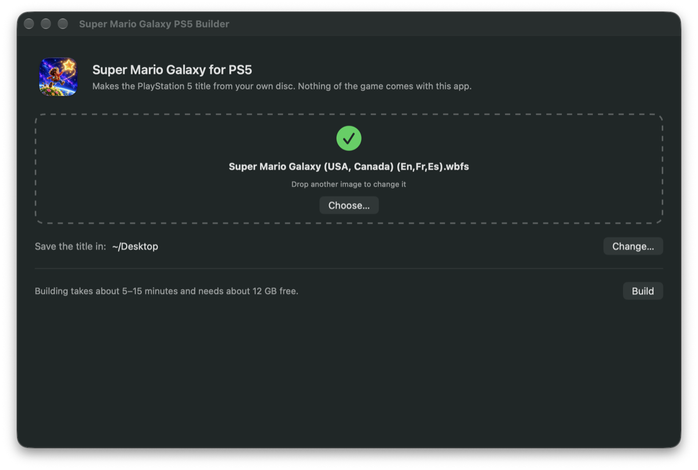

# Super Mario Galaxy for the PlayStation 5

[](https://github.com/griches/PS5_MarioGalaxy/stargazers)
[](https://github.com/griches/PS5_MarioGalaxy/releases/latest)
[](LICENSE)

**Super Mario Galaxy** (Wii, 2007) as native PS5 homebrew, title `PPSA99315`, at
4K and 60 frames a second. Not an emulator: the game's own code, translated
into C++ by [Nebula](https://github.com/keepvaibin/nebula) and compiled for the
console. Version 1.0.0.

You make the title yourself, from **your own disc**, with a small builder app
for the Mac or Windows. Nothing of the game is in any download here.

> **USA disc only, revision 0.** You need your own image of **Super Mario Galaxy
> for the USA (`RMGE01`), revision 0**, the first printing. The European, Japanese,
> Korean and later USA printings are not supported (Nebula translates that one
> disc). The builder checks your image before it starts.

## What you need

- A PS5 that runs homebrew (etaHEN or similar), with **ShadowMountPlus** and an
  **FTP server** (port 2121).
- A computer to build the title on, either:
  - a **Mac with Apple silicon** (M1 or later) on macOS 13 or later, or
  - a **Windows 10 or 11** PC (64-bit).

  About **12 GB free** on it while it builds.
- Your own image of the disc: `.iso`, `.wbfs`, `.rvz`, `.wia`, `.ciso` or `.gcz`
  all work.
- An FTP program (FileZilla, for example) and, for the HD textures, a program
  that opens `.7z` files (7-Zip on Windows, Keka or The Unarchiver on a Mac).

## Set it up

### 1. Build the title

<p align="center"></p>

1. From the [latest release](https://github.com/griches/PS5_MarioGalaxy/releases/latest),
   download the builder for your computer and unzip it:
   - **Mac**: `SuperMarioGalaxy-PS5-Builder-1.0.0-mac.zip` gives you the app
     **Super Mario Galaxy PS5 Builder**. Move it to Applications if you like and
     open it.
   - **Windows**: `SuperMarioGalaxy-PS5-Builder-1.0.0-windows.zip` gives you a
     folder **Super Mario Galaxy PS5 Builder**. Open
     **Super Mario Galaxy PS5 Builder.exe** in it. Keep the folder together: the
     app needs the `kit` folder and `galaxy-builder.exe` beside it. If SmartScreen
     says it doesn't know the app, choose **More info**, then **Run anyway**.
2. **Drop your disc image onto the window**, or click **Choose…** and pick it.
3. The title is saved on your **Desktop**. **Change…** picks another folder
   (on a drive with about 12 GB free).
4. Click **Build**. The window shows each step as it goes: checking your disc
   (the wrong region or revision stops it here, with the reason), extracting it,
   translating the game's code, making the game's data, compiling it all for the
   PS5, linking, and putting the title together. It takes about **4 minutes**
   on an Apple silicon Mac and about **10 minutes** on a fast PC (longer on
   fewer cores). You can use the computer meanwhile; **Cancel** stops it.
   **Show details** has every tool's output, if something goes wrong.
5. When it says **Your title is ready**, **Show in Finder** (Mac) or **Open
   folder** (Windows) shows you the result: a folder called **`PPSA99315`**
   (about 4.5 GB).

The builder downloads nothing and changes nothing else on your computer. Its
temporary files (about 8 GB, in a `PPSA99315-build` folder beside the title) are
removed when it finishes or stops; after a **Cancel**, the next build clears them.

> The title you build contains code translated from your disc. It is for your own
> console: please don't share it.

### 2. Copy it to the PS5

Copy the `PPSA99315` folder to the console over FTP, as `/data/homebrew/PPSA99315/`.
Its `content/game.pak` is 4.3 GB, so this takes a few minutes.

### 3. The HD textures (recommended)

The **Super Mario Galaxy HD Texture Mod** by **CDAMJC** and **razius**, with
**Bighead**'s extra additions: about 750 of the game's textures redrawn at four
to eight times their resolution, in Dolphin's DDS format.

| Download | What it is | Size |
| --- | --- | --- |
| **[Super Mario Galaxy HD texture packs](https://drive.google.com/drive/folders/1SwN5iBekCtjLaltkFZ_vzQApzSU3Rltb)** (Google Drive) | Take **`SMG1 HD Textures Full Size DDS.7z`**: the DDS version. A PNG version won't load. | 595&nbsp;MB&nbsp;`.7z`, 1.8&nbsp;GB unpacked |

The pack's own page, with its history and credits, is the
[Dolphin forum thread](https://forums.dolphin-emu.org/Thread-super-mario-galaxy-1-hd-texture-mod).

1. Unpack it on your computer. You get a folder called `SMG1 HD Textures Full Size DDS`.
2. Make a folder called `textures` in `/data/homebrew/PPSA99315/` and copy that
   folder into it. Leave the folder as it is: the game finds the textures by
   their names, in any folder under `textures/`.

The textures load as you play, so each one appears a moment after the area
it's in. The pack stays compressed in the console's graphics memory.

### 4. Check the folder

When you're done it looks like this:

```
/data/homebrew/PPSA99315/
├── eboot.bin, sce_sys/, sce_module/, licenses/
├── RMGE01_boot_image.bin
├── content/
│   ├── game.pak
│   └── sys/, files/, ticket.bin, tmd.bin
└── textures/
    └── SMG1 HD Textures Full Size DDS/
        └── RMG/
```

Everything except `textures/` came from the builder.

### 5. Play

1. Start **Super Mario Galaxy** from the home screen.
2. The corner of the screen says how to open the settings: hold the **touchpad
   button** and press **Options**.

The defaults are the best picture: 4K at 60 frames a second, the game drawn at
six times its own resolution and smoothed (anti-aliasing **Auto**), widescreen,
and the HD textures if they're there.

### If something's wrong

- **It isn't on the home screen**: restart ShadowMountPlus (or the console).
- **The builder says the disc can't be used**: it says why. Most often it's
  another printing of the game (European, or a later USA revision); only the
  first USA printing works.
- **The builder stops while compiling**: see **Show details** for the reason.
  Check there are 12 GB free, then **Try again**.
- **No HD textures**: the pack isn't inside `textures/`, or it's the PNG
  version. Check the folder against the one above, then close the game and
  start it again: it looks for the pack as it starts.
- **A short hitch the first time through an area**: the console is preparing
  that area's shaders. The next time it's smooth.

### Updating

Build the new version with the new builder and copy its `PPSA99315` folder over
the old one. Your saves and settings stay: they live in
`/data/homebrew/PPSA99315/userdata/` (`saves/` is the Wii's memory, `Nebula/`
the settings), which the builder never makes.

## What is better than on the Wii

- **4K at 60 frames a second**, drawn at up to six times the Wii's resolution,
  with anti-aliasing (SMAA, FXAA or Auto) and anisotropic filtering.
- **Widescreen** as the game draws it, not stretched.
- **HD texture packs** in Dolphin's DDS format.
- **The DualSense** in place of the Wii Remote and Nunchuk: the pointer on the
  right stick, every button remappable, and PlayStation buttons in the settings.
- **A settings menu** in the game: display, graphics, controls, audio, language
  (English, French or Spanish) and text speed.
- **Native**: the game's code runs as x86-64 on the console's own CPU.

## Controls

| Action | DualSense |
| --- | --- |
| Move (Nunchuk stick) |  |
| Jump (Wii A) |  |
| Spin (shake the Wii Remote) | , ,  or  |
| Shoot Star Bits (Wii B) |  |
| Crouch, ground pound (Z) |  |
| Reset the camera (C) |  |
| Move the pointer |  |
| Re-centre the pointer (hold: keep it in the middle) |  |
| Back out of a menu (jumps in play) |  |
| Pause (+) |  |
| − | touchpad button |
| Wii D-pad | D-pad |
| **This port's settings** | hold the **touchpad button**, press  |

The game's own prompts still show the Wii Remote's buttons: **A** is
 and **B** is
.

In the settings menu the D-pad moves and changes, 
changes,  applies,
 undoes,
 and 
change page, and  closes it.
**Controls** rebinds any of the Wii's buttons and sets the pointer's speed and
deadzones and the vibration.

## Known limits (1.0.0)

- Only the first USA printing of the disc (`RMGE01`, revision 0).
- No motion controls: the pointer is on the right stick, and spins are buttons.
- The game's prompts show the Wii Remote's buttons (above).
- 30 or 60 frames a second (a 120 Hz mode was tried and taken out: the game's
  animated models broke in the frames in between).
- The builder needs an Apple silicon Mac or a 64-bit Windows PC.
- Played through the opening, the file select, saving and the Comet Observatory
  hub on a PS5; not yet to the end.

## How it works

- **Nebula** ([keepvaibin/nebula](https://github.com/keepvaibin/nebula)) translates
  the game's PowerPC code into C++ ahead of time and runs it on its own runtime,
  which stands in for the Wii's graphics (GX), sound (DSP), storage and system
  software. It is a Windows program; this port keeps it as it is, on a Win32
  compatibility layer for the console (`ps5/compat`: files, threads and fibers,
  exceptions, windows, XInput for the DualSense, XAudio2).
- **Graphics**: Nebula's own Direct3D 12 renderer, unchanged, on
  [vkd3d](https://gitlab.winehq.org/wine/vkd3d) (Wine's Direct3D 12 on Vulkan),
  over the RADV driver linked into the title
  ([PS5_Vulkan](https://github.com/mihawk-99/PS5_Vulkan)), output through
  `VK_KHR_display` at 3840x2160 (`ps5/gx`).
- **HD textures**: `ps5/gx/texture_pack.cpp` indexes `textures/` by Dolphin's
  file names, hashes each texture as Dolphin does and swaps in its DDS as it loads.
- **The builder** (`ps5/builder`): `nebula-recomp` (Nebula's recompiler) extracts
  and translates the player's disc, LLVM 22's clang compiles the translation
  for the console and links it to the rest of the title, which comes in the
  builder's kit already built. The kit's link is recorded from this repository's
  own build, so a title built from the same disc is byte-identical to the
  developer's.
- What the console needs changed in Nebula is `ps5/patches/nebula.patch`, every
  hunk behind `GALAXY_PS5`.

## Build from source

From macOS, through the Lima VM `ps5` that holds the PS5 stack (PS5_Vulkan,
PS5_Mesa, PS5_PayloadSDK, LLVM 22), with Rust on the Mac:

```sh
git clone --recursive https://github.com/griches/PS5_MarioGalaxy
cd PS5_MarioGalaxy
ps5/tools/prepare-game.sh /path/to/your/RMGE01.iso --content   # patch Nebula, translate the disc
ps5/tools/vm.sh build                   # -> dist/PPSA99315/ (eboot.bin, sce_sys, licences)
bash ps5/tools/console.sh deploy        # the title over FTP (PS5_HOST in ../PS5_Vulkan/.env)
bash ps5/tools/console.sh game-files    # content/ and the boot image
bash ps5/tools/console.sh textures      # an HD pack from gamedata/textures
bash ps5/tools/console.sh run 60        # launch and follow klog
```

`console.sh env KEY=VALUE...` writes the title's `env.txt`, the runtime's
environment (Nebula's `GALAXY_*` options; `GALAXY_PS5_TEXPACK_MB` sets the HD
pack's graphics memory budget, 2048 MB by default).

The builder apps:

```sh
ps5/builder/build-tools-mac.sh                      # nebula-recomp, ps5-native-tool, galaxy-builder
ps5/builder/build-tools-windows.sh USER@PC          # the same for Windows, built on a PC over SSH
ps5/builder/make-kit.sh mac build/builder-kit-mac   # the kits (a VM build records the link)
ps5/builder/make-kit.sh windows build/builder-kit-windows
NOTARY_KEY_JSON=~/key.json ps5/builder/mac/build-app.sh 1.0.0   # the signed, notarised Mac app
ps5/builder/package-windows.sh 1.0.0                # the Windows zip
```

The home-screen art (`ps5/art`, converted by `ps5/art/make-title-art.sh`) is
the port's own, made with ChatGPT in the style of the game's cover; nothing in
it is from the game.

## Credits

- **Nebula** by **keepvaibin**: the recompiler and runtime this port is built on.
- **Super Mario Galaxy HD Texture Mod** by **CDAMJC** and **razius**, extra
  additions by **Bighead**.
- [vkd3d](https://gitlab.winehq.org/wine/vkd3d) (the Wine project),
  [Mesa](https://mesa3d.org)'s RADV, [PS5_Vulkan](https://github.com/mihawk-99/PS5_Vulkan),
  the [PS5 Payload SDK](https://github.com/ps5-payload-dev/sdk) (John Törnblom),
  [LLVM](https://llvm.org), [zlib](https://zlib.net), xxHash's algorithm (Yann Collet),
  and the free DSP ROM from [Dolphin](https://dolphin-emu.org) that Nebula's
  recompiler carries.
- Button pictures: Kenney's [Input Prompts](https://kenney.nl/assets/input-prompts) (CC0).

## Licence

GPL-3.0, as Nebula. The title and the builder carry every component's licence
text in `licenses/` (vkd3d is LGPL-2.1, Mesa MIT, LLVM Apache-2.0 with LLVM
exceptions, zlib's and xxHash's their own).

Not affiliated with or endorsed by Nintendo. Super Mario Galaxy is a trademark
of Nintendo. No part of the game is in this repository or its downloads: the
title is made from your own disc.
